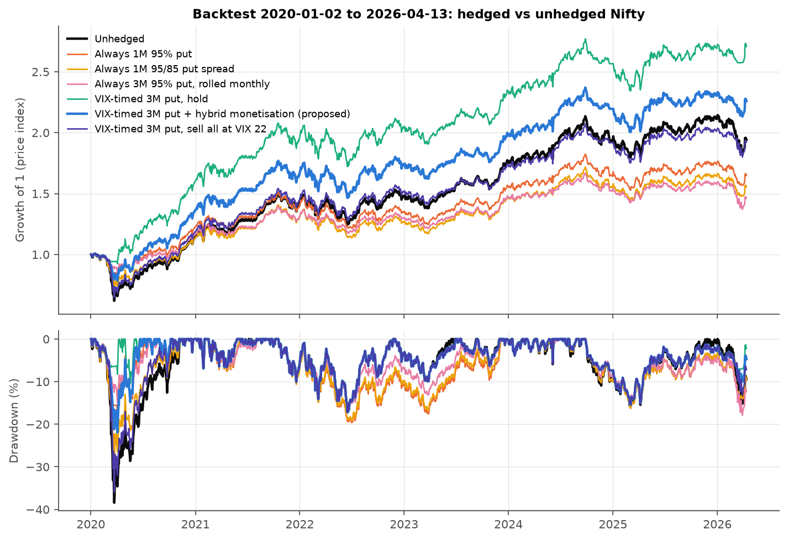

# Volatility Dynamics and the Fear Index: Nifty 50, India VIX and a VIX-timed put hedge

Course project for Financial Derivatives and Risk Management (FDRM), IIT Jodhpur, built solo by **Subham Agrawal**: data, code, analysis, report and the live app.

[](https://subham-fdrm-vix.streamlit.app) [](https://colab.research.google.com/github/Subham1709/FDRM_VIX/blob/main/fdrm_vix_analysis_colab.ipynb)

**Live app:** https://subham-fdrm-vix.streamlit.app (a plain-English introduction with an insurance cost calculator, then the backtest, VIX regimes, option overpricing, the 2024 election and the robustness check; code in [`app/`](app/))

A study of Nifty 50 options through India VIX, using daily data from January 2020 to April 2026. It covers:

1. **Implied vs realised volatility:** the volatility risk premium (VRP) in Nifty options.
2. **India VIX:** how NSE builds it (re-implemented and checked) and how it works as a sentiment gauge.
3. **VIX regimes and Nifty returns:** Low (VIX below 13), Normal (13 to 20), High (above 20).
4. **The 4 June 2024 election result:** how option premiums behaved around a scheduled shock compared with normal days.
5. **A protection strategy:** Nifty puts bought only when VIX is low and sold into volatility spikes, backtested against six alternatives with cost and payoff broken down by VIX regime.



## Main findings

| | Result |
| --- | --- |
| Volatility risk premium | India VIX averaged 2.2 vol points above the volatility Nifty delivered over the next 21 trading days (positive on 78% of days, Newey-West t = 2.8); 4.0 points in the high-VIX regime |
| Regimes | Nifty volatility was 9% a year in low-VIX regimes and 30% in high ones; average returns did not differ significantly (Kruskal-Wallis p = 0.66) |
| 4 June 2024 | Premiums doubled over six weeks; Nifty fell 5.9% on result day against an implied event move of 5.8%; VIX fell 29% the next day |
| Proposed hedge | 13.9% a year against 11.1% unhedged, maximum drawdown −22% against −38%, puts held 45% of the time |
| Caveat | Almost all of the hedge's edge comes from one put held through the March 2020 crash. From July 2020 it returned 14.9% against 15.4% unhedged, about 0.5% a year of insurance cost |

**The proposed hedge.** On the first trading day of each month, if India VIX closes below 13, buy a 3-month Nifty put 5% below spot on the whole portfolio (roll it while VIX stays low; buy nothing new at VIX 13 or above). Sell half the first day VIX closes at 22 or higher, and the rest once VIX falls 20% from its peak. Reinvest the proceeds in Nifty.

| Strategy | CAGR | Volatility | Sharpe | Max drawdown | Net hedge cost a year |
| --- | --- | --- | --- | --- | --- |
| Unhedged | 11.1% | 18.3% | 0.25 | −38.4% | 0 |
| Always 1-month 95% put | 8.3% | 13.2% | 0.14 | −19.6% | 3.0% |
| Always 1-month 95/85 put spread | 7.3% | 15.0% | 0.05 | −30.2% | 3.6% |
| Always 3-month 95% put, rolled monthly | 6.3% | 11.7% | −0.02 | −17.9% | 4.9% |
| VIX-timed 3-month put, held | 17.2% | 14.6% | 0.74 | −17.2% | −4.4% |
| **VIX-timed 3-month put, hybrid selling (proposed)** | **13.9%** | **15.4%** | **0.48** | **−22.0%** | **−2.2%** |
| VIX-timed 3-month put, sell all at VIX 22 | 11.0% | 17.7% | 0.25 | −35.9% | 0.2% |

A negative hedge cost means the options made money. Every number in the report comes from `output/results.json`.

## How to run it

**On your computer** (Python 3.10 or later):

```bash
pip install -r requirements.txt
python fdrm_vix_analysis.py
```

It takes about 30 seconds and writes 8 charts to `figures/`, the tables to `output/` and every quoted number to `output/results.json`. `fdrm_vix_analysis.ipynb` is the same script as an executed notebook. All assumptions (risk-free rate, skew, spread, VIX thresholds, tenor, strike) are constants at the top of the script.

**In Google Colab:** click the badge at the top, or open `fdrm_vix_analysis_colab.ipynb` in Colab. In its first code cell, set `DATA_SOURCE`:

- `"repo"` (the default) downloads the two CSVs from this repository. This reproduces the numbers above.
- `"live"` downloads Nifty 50 (`^NSEI`) and India VIX (`^INDIAVIX`) from Yahoo Finance with `yfinance`, up to today. The numbers will differ from the ones above, which stop at 13 April 2026.
- `"upload"` asks you to select the two CSVs from `data/`.

Then use Runtime > Run all. Charts and tables appear in the Files panel (folder icon on the left).

## What's in the repo

| Path | Contents |
| --- | --- |
| `fdrm_vix_analysis.py` | The whole analysis: data loading, India VIX formula check, VRP, regime statistics, election event study, backtest engine, sensitivity tests |
| `fdrm_vix_analysis.ipynb` | The same script as an executed notebook |
| `fdrm_vix_analysis_colab.ipynb` | Colab version with a live-data or upload option |
| `data/` | The two input series (see below) |
| `figures/` | The 8 charts |
| `output/` | Every table: performance, regime statistics, the election window, cost and payoff by regime, every option trade of each strategy (`ledger_*.csv`), sensitivity grids, and `results.json` |
| `docs/fdrm_vix_report.pdf` | The written report (14 pages) |
| `docs/fdrm_vix_presentation.pptx`, `.pdf` | 17-slide presentation with speaker notes |
| `docs/fdrm_vix_results.xlsx` | Every result table in one Excel workbook, built by `build_workbook.py` |
| `docs/fdrm_vix_study_guide.pdf` | Study guide (21 pages): theory, data, results, likely questions, the code, every slide, glossary |
| `docs/fdrm_vix_study_guide_full.pdf` | Full study guide (67 pages) |
| `docs/fdrm_vix_code_walkthrough.pdf` | The script explained line by line (29 pages) |
| `build_deck.js`, `package.json` | Builds the presentation with pptxgenjs: `npm install`, then `npm run deck` |

## Data

| File | Series | Dates | Source |
| --- | --- | --- | --- |
| `data/nifty50_daily_raw.csv` | Nifty 50 (`^NSEI`) daily OHLC | 17 Sep 2007 to 13 Apr 2026 | Yahoo Finance, via [kalilurrahman/NIFTY_50_STOCK_DATA](https://github.com/kalilurrahman/NIFTY_50_STOCK_DATA) |
| `data/india_vix_daily_raw.csv` | India VIX (`^INDIAVIX`) daily OHLC | 2 Jan 2020 to 24 Aug 2026 | Yahoo Finance, via [tanya459/india-vix-market-data-analysis](https://github.com/tanya459/india-vix-market-data-analysis) |

The analysis uses the 1,536 trading days on which both exist (2 Jan 2020 to 13 Apr 2026). Spot checks against NSE: Nifty closed at 21,884.50 and India VIX at 26.75 on 4 June 2024.

## Method and limitations

- **Option prices are modelled, not traded.** Historical Nifty option chains were not available, so premiums are Black-Scholes-Merton prices with implied volatility = India VIX + 0.6 vol points per 1% out of the money, a 0.5 vol point half-spread, r = 6.5% and q = 1.3%. The ranking of strategies held for skew from 0 to 1 point and spreads from 0 to 1 point.
- **VIX is a 30-day measure** used here to price 3-month puts. Real 3-month implied volatility is usually higher in calm markets, so this probably flatters the strategy.
- **Short sample.** Six years with one true crash. The thresholds were chosen on the same data; the sensitivity grids show the conclusions do not depend on the exact values.
- **Simplifications.** Synthetic expiries (first trading day of a later month), trades at the daily close, price index without dividends, no taxes or brokerage.
- **Statistics.** Forward returns overlap, so t-statistics use Newey-West standard errors with lags equal to the horizon.

## Ideas to extend it

Real option prices from NSE F&O bhavcopy files; an out-of-sample test on 2008 to 2019 with the rules frozen; the Nifty 50 Total Returns Index; realistic execution costs; percentile-based or VRP-based entry signals; collars and tail puts; a block bootstrap of outcomes; a live dashboard of today's regime and signal.
